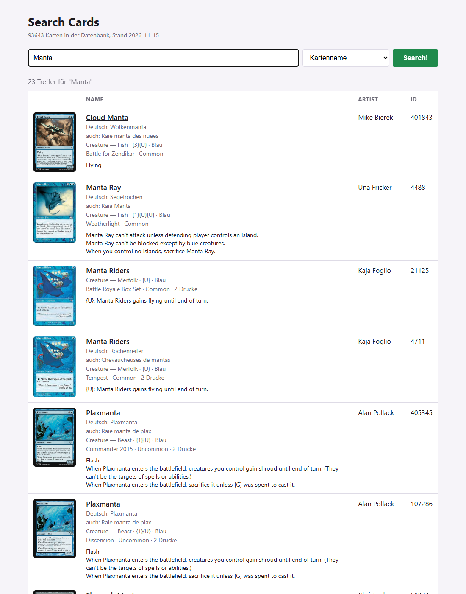

# MTG Trading Card Database By API

Praktische Prüfung Big Data, WS 2026/2027, DHBW Stuttgart.

Die Karten von [api.magicthegathering.io](https://docs.magicthegathering.io/) werden täglich mit Airflow geladen, in HDFS aufbereitet und in eine MySQL-Datenbank geschrieben. Ein kleines Flask-Frontend durchsucht diese Datenbank.

## Ablauf

```
API -> lokale JSON-Dateien -> HDFS raw -> HDFS final (Parquet/Hive) -> MySQL -> Frontend
```

Alles läuft in Docker-Containern auf einer Google-Cloud-VM: `hadoop` (HDFS, Hive, Spark), `airflow`, `mysql` und `mtg-frontend`.

## Datenquelle

Die Karten kommen seitenweise über `GET https://api.magicthegathering.io/v1/cards?page=N&pageSize=100`. Jede Antwort enthält bis zu 100 Karten, die Gesamtzahl steht im Header `Total-Count` (zurzeit etwa 93.600 Karten, also gut 900 Seiten). Die API erlaubt 1000 Requests, das reicht für einen kompletten Abzug.

Jede Karte ist ein Druck aus einem bestimmten Set. Dieselbe Karte kann also mehrfach vorkommen, jeweils mit eigener `id`. Die Übersetzungen stehen im Feld `foreignNames`.

Das Download-Skript holt zuerst Seite 1, um die Seitenzahl zu kennen, und lädt dann die restlichen Seiten mit 4 parallelen Downloads. Jede Seite wird als eigene JSON-Datei gespeichert. Bei Fehlern wird der Request nach einer Pause wiederholt.

## Airflow-DAG `MTG`

Datei: [airflow/dags/mtg.py](airflow/dags/mtg.py). Der DAG läuft täglich um 03:00 Uhr und kann auch manuell gestartet werden.

| # | Task | Was er macht |
|---|---|---|
| 1 | `create_import_dir` | Legt das lokale Verzeichnis `/home/airflow/mtg` an |
| 2 | `clear_import_dir` | Leert das Verzeichnis |
| 3 | `download_mtg_cards` | Lädt alle Karten von der API (`download_mtg_cards.py`) |
| 4 | `clear_hdfs_raw_partition_dir` | Löscht die Raw-Partition des Tages, falls der Lauf wiederholt wird |
| 5 | `mkdir_hdfs_raw_partition_dir` | Legt `/user/hadoop/mtg/raw/YYYY/MM/DD` an |
| 6 | `upload_raw_cards_to_hdfs` | Kopiert die JSON-Dateien nach HDFS |
| 7 | `pyspark_raw_to_final` | Spark-Job raw -> final |
| 8 | `create_hive_table_mtg_cards` | Hive-Tabelle über den Final-Daten |
| 9 | `create_hive_table_mtg_foreign_names` | Hive-Tabelle für die Übersetzungen |
| 10 | `prepare_mysql_tables` | Legt die MySQL-Tabellen und leere Staging-Tabellen an |
| 11 | `pyspark_final_to_mysql` | Spark-Job final -> MySQL (Staging-Tabellen) |
| 12 | `publish_mysql_tables` | Prüft die Staging-Tabellen und tauscht sie gegen die alten Tabellen |
| 13 | `cleanup_hdfs_raw` | Löscht alte Raw-Daten, die letzten 3 Tage bleiben |

Die Tasks laufen nacheinander, nur 8 und 9 laufen parallel.


Einstellungen in Airflow:
- Variable `mtg_max_pages`: `0` lädt alles, z. B. `5` nur 5 Seiten für einen Testlauf.
- Connection `mtg_mysql`: Zugangsdaten für MySQL.
- Datei `mtg_mysql.env` im Airflow-Container: Zugangsdaten für den Spark-Job, damit das Passwort nicht im `spark-submit`-Aufruf steht.

Ein kompletter Lauf hat am 16.11.2026 etwa 10 Minuten gedauert, am längsten der Upload nach HDFS (ca. 5 min). Danach waren 93.643 Karten und 358.564 übersetzte Namen in der Datenbank. Die Raw-Daten sind 351 MB groß, die Final-Daten als Parquet nur 37 MB.

## Business Rules

**raw -> final** ([pyspark_mtg_raw_to_final.py](airflow/python/pyspark_mtg_raw_to_final.py))
- Die Seiten werden in eine Zeile pro Karte aufgeteilt (`explode`).
- Es werden nur die Felder übernommen, die für die Suche gebraucht werden.
- Texte werden getrimmt, leere Werte werden `NULL`, Listen wie Farben werden zu Text mit Kommas.
- `multiverseid` wird zu einer Zahl (die API liefert es mal als Zahl, mal als Text).
- Karten ohne `id` oder `name` fliegen raus, doppelte `id`s werden entfernt.
- Die Übersetzungen kommen in eine eigene Tabelle `foreign_names`.
- Gespeichert wird als Parquet.

**final -> MySQL** ([pyspark_mtg_final_to_mysql.py](airflow/python/pyspark_mtg_final_to_mysql.py))

Hier werden die Daten zusätzlich angereichert:
- `name_de`: deutscher Kartenname aus den Übersetzungen
- `color_names`: Farben auf Deutsch (`W` -> Weiß, `U` -> Blau, `B` -> Schwarz, `R` -> Rot, `G` -> Grün)
- `search_name` / `search_all`: Suchspalten in Kleinbuchstaben, ohne Akzente, `ß` wird zu `ss`. Dadurch findet „weiss“ auch „Weiß“.
- `has_image`: ob es ein Bild gibt
- `printings_count`: wie oft die Karte gedruckt wurde
- `load_date`: Datum des Laufs

Der Spark-Job schreibt in Staging-Tabellen. Erst wenn diese nicht leer sind (und bei einem kompletten Lauf nicht deutlich kleiner als vorher), werden sie mit `RENAME TABLE` gegen die alten Tabellen getauscht. So bleibt die Suche während des Ladens nutzbar und eine fehlerhafte API-Antwort leert nicht die Datenbank.

## Datenmodell

- Raw: `/user/hadoop/mtg/raw/YYYY/MM/DD/*.json`, die API-Antworten unverändert
- Final (HDFS + Hive): [mtg_cards](ddl/hive/mtg_cards.sql), [mtg_foreign_names](ddl/hive/mtg_foreign_names.sql)
- MySQL (Datenbank `mtg`): [cards](ddl/mysql/cards.sql), [foreign_names](ddl/mysql/foreign_names.sql)

Die Staging-Tabellen werden aus denselben DDL-Dateien erzeugt und haben deshalb keine eigene Datei.

## Frontend

Code: [frontend/app.py](frontend/app.py) und [frontend/templates/](frontend/templates/), läuft als Docker-Container auf Port 5000.

Man gibt einen Suchbegriff ein und wählt, ob im Namen, im Text, beim Artist oder überall gesucht wird. Gesucht wird auch in den übersetzten Namen. Wie im Beispiel der Aufgabe findet „Manta“ also „Manta Riders“ und „Cloud Manta“ (deutsch „Wolkenmanta“). Die Treffer werden mit Bild, Name, Typ, Set, Text, Artist und ID angezeigt. Über den Namen kommt man auf eine Detailseite mit allen Übersetzungen und den anderen Drucken der Karte.



## Installation

Voraussetzung: Die Container `hadoop` und `airflow` laufen wie in der Vorlesung im Netz `bigdatanet`.

| Skript | Zweck |
|---|---|
| [setup/setup_vm.sh](setup/setup_vm.sh) | Einmalig: startet MySQL und Frontend, richtet Airflow ein |
| [setup/deploy.sh](setup/deploy.sh) | Kopiert DAG, Skripte und DDLs in den Airflow-Container |
| [setup/start_services.sh](setup/start_services.sh) | Startet nach einem Neustart der VM alles wieder |
| [setup/dag_status.sh](setup/dag_status.sh) | Zeigt den Status der DAG-Läufe |

Danach den DAG `MTG` in Airflow (`http://<VM-IP>:8080/admin/`) starten. Das Frontend ist unter `http://<VM-IP>:5000/` erreichbar.
