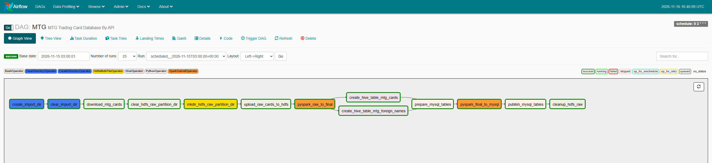

# MTG Trading Card Database By API

Praktische Prüfung Big Data, Wintersemester 2026/2027, DHBW Stuttgart.

Ziel: Aus den Daten von [api.magicthegathering.io](https://docs.magicthegathering.io/) entsteht eine durchsuchbare Datenbank aller Magic-The-Gathering-Karten. Der gesamte Datenfluss läuft automatisiert als Airflow-DAG.

## 1. Überblick

```
api.magicthegathering.io
        |  download_mtg_cards.py (HTTP GET, 100 Karten pro Seite)
        v
lokal: /home/airflow/mtg/cards_page_*.json
        |  hadoop fs -put
        v
HDFS raw:   /user/hadoop/mtg/raw/YYYY/MM/DD/*.json      (unveränderte API-Antworten)
        |  PySpark: pyspark_mtg_raw_to_final.py
        v
HDFS final: /user/hadoop/mtg/final/cards                (Parquet, Hive-Tabelle mtg_cards)
            /user/hadoop/mtg/final/foreign_names        (Parquet, Hive-Tabelle mtg_foreign_names)
        |  PySpark: pyspark_mtg_final_to_mysql.py (Anreicherung, JDBC)
        v
MySQL (Datenbank mtg): cards_staging, foreign_names_staging
        |  Prüfung + RENAME TABLE (atomarer Tausch)
        v
MySQL (Datenbank mtg): cards, foreign_names
        |  SQL
        v
Frontend (Flask): Suche nach Kartenname, Text oder Artist
```

| Komponente | Container | Aufgabe |
|---|---|---|
| Hadoop, YARN, Hive, Spark | `hadoop` (`marcelmittelstaedt/spark_base`) | HDFS-Speicher, Ausführung der Spark-Jobs, HiveServer2 |
| Airflow 1.10 | `airflow` (`marcelmittelstaedt/airflow`) | ETL-Workflow, Scheduling |
| MySQL 8.0 | `mysql` | Endnutzer-Datenbank |
| Frontend | `mtg-frontend` | Suchoberfläche, Port 5000 |

Alle Container laufen im Docker-Netz `bigdatanet` auf einer Google-Cloud-VM.

## 2. Datenquelle

- Endpunkt: `GET https://api.magicthegathering.io/v1/cards?page=N&pageSize=100`
- Antwort: ein JSON-Dokument `{"cards": [ {...}, ... ]}` mit bis zu 100 Karten.
- Die Gesamtzahl der Karten steht im Antwort-Header `Total-Count` (aktuell rund 93.600 Karten, also rund 940 Seiten).
- Die API ist rate-limitiert (Header `Ratelimit-Limit: 1000`). Ein Komplettabzug braucht rund 940 Requests.
- Jede Karte ist ein *Druck* (Printing): Dieselbe Karte kommt in mehreren Sets vor und hat pro Set eine eigene `id`.
- Übersetzte Namen stehen im verschachtelten Feld `foreignNames`.

Vorgehen beim Abruf: Die erste Seite liefert die Gesamtzahl, daraus ergibt sich die Seitenzahl. Die restlichen Seiten werden mit vier parallelen Downloads geholt. Jede Antwort wird unverändert als eigene Datei gespeichert. Bei Fehlern oder erreichtem Rate-Limit wird der Request mit wachsender Pause wiederholt.

## 3. Airflow-DAG `MTG`

Datei: [airflow/dags/mtg.py](airflow/dags/mtg.py). Der DAG läuft automatisch täglich um 03:00 Uhr UTC (`schedule_interval='0 3 * * *'`) und kann in der Airflow-Oberfläche manuell gestartet werden.

| # | Task | Operator | Zweck |
|---|---|---|---|
| 1 | `create_import_dir` | `CreateDirectoryOperator` | Legt das lokale Importverzeichnis `/home/airflow/mtg` an. |
| 2 | `clear_import_dir` | `ClearDirectoryOperator` | Leert das Importverzeichnis, damit keine Dateien eines früheren Laufs übrig bleiben. |
| 3 | `download_mtg_cards` | `BashOperator` | Ruft `download_mtg_cards.py` auf und lädt alle Karten seitenweise von der API. |
| 4 | `clear_hdfs_raw_partition_dir` | `BashOperator` | Löscht die Raw-Partition des Lauftags in HDFS, damit ein wiederholter Lauf keine Dubletten erzeugt. |
| 5 | `mkdir_hdfs_raw_partition_dir` | `HdfsMkdirFileOperator` | Legt die Raw-Partition `/user/hadoop/mtg/raw/YYYY/MM/DD` an. |
| 6 | `upload_raw_cards_to_hdfs` | `BashOperator` | Kopiert die JSON-Dateien unverändert nach HDFS. |
| 7 | `pyspark_raw_to_final` | `SparkSubmitOperator` | Überführt die Rohdaten in den Final Layer (siehe Business Rules). |
| 8 | `create_hive_table_mtg_cards` | `HiveOperator` | Legt die externe Hive-Tabelle `mtg_cards` über dem Final Layer an. |
| 9 | `create_hive_table_mtg_foreign_names` | `HiveOperator` | Legt die externe Hive-Tabelle `mtg_foreign_names` an. |
| 10 | `prepare_mysql_tables` | `PythonOperator` | Legt `cards` und `foreign_names` an, falls sie fehlen, und erzeugt leere Staging-Tabellen `cards_staging` und `foreign_names_staging` aus denselben DDL-Dateien. |
| 11 | `pyspark_final_to_mysql` | `SparkSubmitOperator` | Reichert die Daten an und lädt sie in die Staging-Tabellen. |
| 12 | `publish_mysql_tables` | `PythonOperator` | Prüft die Staging-Tabellen und tauscht sie mit `RENAME TABLE` in einem Schritt gegen die Live-Tabellen. |
| 13 | `cleanup_hdfs_raw` | `BashOperator` | Löscht alte Raw-Partitionen in HDFS, die neuesten 3 Tage bleiben. |

Reihenfolge: 1 -> 2 -> 3 -> 4 -> 5 -> 6 -> 7 -> (8 und 9 parallel) -> 10 -> 11 -> 12 -> 13.



Einstellungen in Airflow:
- **Variable `mtg_max_pages`:** `0` lädt alle Seiten (Standard). Eine andere Zahl begrenzt den Abruf, z. B. `5` für einen schnellen Testlauf.
- **Connection `mtg_mysql`:** Zugangsdaten der MySQL-Datenbank für die Python-Tasks. Der DAG liest sie zur Laufzeit; im Code stehen keine Passwörter.
- **Datei `/home/airflow/airflow/mtg_mysql.env`:** Zugangsdaten für den Spark-Export, nur für den Benutzer `airflow` lesbar (legt `setup/deploy.sh` an). So steht das Passwort weder in der `spark-submit`-Kommandozeile noch in den Logs oder in der Airflow-Oberfläche.
- **Connections `hdfs`, `spark`, `beeline`:** sind im Airflow-Image der Vorlesung bereits vorhanden.

### Ergebnis eines Volllaufs (16.11.2026)

Lauf `scheduled__2026-11-15T03:00:00` auf der Google-Cloud-VM (n2-highmem-4), alle Tasks erfolgreich:

| Task | Dauer |
|---|---|
| `create_import_dir`, `clear_import_dir` | 2 s |
| `download_mtg_cards` | 99 s |
| `clear_hdfs_raw_partition_dir`, `mkdir_hdfs_raw_partition_dir` | 12 s |
| `upload_raw_cards_to_hdfs` | 293 s |
| `pyspark_raw_to_final` | 70 s |
| `create_hive_table_mtg_cards`, `create_hive_table_mtg_foreign_names` | je 4 s (parallel) |
| `prepare_mysql_tables` | 1 s |
| `pyspark_final_to_mysql` | 82 s |
| `publish_mysql_tables` | 2 s |
| `cleanup_hdfs_raw` | 3 s |
| **Summe der Taskdauern** | **ca. 9,5 min** |

Den größten Anteil hat der Upload der 937 JSON-Dateien nach HDFS, nicht der API-Abruf (dank 4 paralleler Downloads).

| Kennzahl | Wert |
|---|---|
| API-Seiten (Raw-Dateien) | 937 |
| Karten (Drucke) in `cards` | 93.643 |
| davon mit deutschem Namen (`name_de`) | 47.067 |
| davon mit Bild (`has_image = 1`) | 63.808 |
| davon mit Farbe (`color_names`) | 73.235 |
| übersetzte Namen in `foreign_names` | 358.564 |
| Raw Layer (JSON) | 351,3 MB |
| Final Layer (Parquet, `cards` + `foreign_names`) | 37,3 MB, rund 10-mal kleiner als Raw |

Stichproben im Frontend nach dem Lauf: „Manta“ (Kartenname) liefert 23 Treffer, darunter „Cloud Manta“ mit dem deutschen Namen „Wolkenmanta“. „weiss“ (alle Felder) liefert 116 Treffer, „aether“ (Kartenname) 214 Treffer.

## 4. Skripte

| Datei | Zweck |
|---|---|
| [airflow/python/download_mtg_cards.py](airflow/python/download_mtg_cards.py) | Lädt die Karten seitenweise von der API und speichert jede Antwort als `cards_page_NNNNN.json`. |
| [airflow/python/pyspark_mtg_raw_to_final.py](airflow/python/pyspark_mtg_raw_to_final.py) | Spark-Job Raw -> Final. |
| [airflow/python/pyspark_mtg_final_to_mysql.py](airflow/python/pyspark_mtg_final_to_mysql.py) | Spark-Job Final -> MySQL. |

### Business Rules Raw -> Final

- **Flatten:** Aus einem JSON-Dokument pro Seite wird eine Zeile pro Karte (`explode`).
- **Reduce:** Ein festes Schema liest nur die Attribute, die für die Suche gebraucht werden. Regeln (`rulings`), Legalitäten, Drucklisten und übersetzte Texte entfallen.
- **Clean:** Texte werden getrimmt, leere Strings werden zu `NULL`. Listen (Farben, Typen) werden zu kommagetrennten Strings. `multiverseid` wird zu `INT` vereinheitlicht, weil die API das Feld mal als Zahl und mal als String liefert.
- **Filter:** Karten ohne `id` oder ohne `name` werden verworfen.
- **Deduplicate:** Jede Karten-`id` kommt genau einmal vor.
- **Übersetzungen:** `foreignNames` wird in eine eigene Tabelle ausgelagert (eine Zeile pro Karte und Sprache, Dubletten entfernt).
- **Format:** Parquet, weil es spaltenorientiert und komprimiert ist und das Schema mitführt.

### Business Rules Final -> MySQL (Anreicherung)

| Spalte | Regel | Nutzen |
|---|---|---|
| `name_de` | deutscher Name aus `foreign_names` (`language = 'German'`) | Trefferliste zeigt z. B. „Wolkenmanta“ direkt an |
| `color_names` | Farben auf Deutsch (`W` -> `Weiß`, `U` -> `Blau`, `B` -> `Schwarz`, `R` -> `Rot`, `G` -> `Grün`; die API liefert Kürzel, ältere Daten auch `White`, `Blue` ...) | Anzeige im Frontend |
| `search_name` | englischer und deutscher Name, normalisiert | Namenssuche ohne Unterabfrage |
| `search_all` | Name, deutscher Name, Text und Artist, normalisiert | Suche „in allen Feldern“ über eine Spalte |
| `has_image` | 1, wenn die Karte eine Bild-URL hat | Karten mit Bild stehen vorne |
| `printings_count` | Anzahl der Drucke mit demselben Kartennamen (Window über `name`) | Anzeige „n Drucke“ |
| `load_date` | Datum des Laufs | Datenstand in der Fußzeile |

**Normalisierung:** klein geschrieben, `ß` -> `ss`, `æ` -> `ae`, Akzente und Umlaute entfernt (`ä` -> `a`, `é` -> `e`). Das Frontend normalisiert die Eingabe mit denselben Regeln, deshalb finden „weiss“, „Weiß“ und „WEISS“ dieselben Karten und „aether“ findet „Æther“.

**Laden ohne Ausfallzeit:**
1. `prepare_mysql_tables` legt leere Staging-Tabellen aus denselben DDL-Dateien an (nur der Tabellenname bekommt `_staging`).
2. Spark schreibt in die Staging-Tabellen. Die Live-Tabellen bleiben dabei unberührt, die Suche funktioniert weiter.
3. `publish_mysql_tables` prüft: Staging ist nicht leer, und bei einem Volllauf hat sie höchstens 10 % weniger Karten als bisher. Das schützt davor, dass eine unvollständige Antwort der API die Datenbank leert. Testläufe (`mtg_max_pages > 0`) überspringen die Größenprüfung.
4. `RENAME TABLE cards TO cards_old, cards_staging TO cards, ...` tauscht beide Tabellen in einem atomaren Schritt. Danach werden die alten Tabellen gelöscht. Schlägt eine Prüfung fehl, bleibt der alte Stand online.

## 5. Datenmodell

**Raw Layer (HDFS):** `/user/hadoop/mtg/raw/YYYY/MM/DD/cards_page_NNNNN.json`. Unveränderte API-Antworten, partitioniert nach Ladedatum. Die letzten 3 Tage bleiben erhalten.

**Final Layer (HDFS und Hive):**
- [ddl/hive/mtg_cards.sql](ddl/hive/mtg_cards.sql): eine Zeile pro Kartendruck.
- [ddl/hive/mtg_foreign_names.sql](ddl/hive/mtg_foreign_names.sql): eine Zeile pro Karte und Sprache.

**Endnutzer-Datenbank (MySQL, Datenbank `mtg`):**
- [ddl/mysql/cards.sql](ddl/mysql/cards.sql): Karten mit den angereicherten Spalten (siehe oben). Primärschlüssel `id`, Indizes auf `name`, `artist`, `multiverse_id`.
- [ddl/mysql/foreign_names.sql](ddl/mysql/foreign_names.sql): übersetzte Namen in allen Sprachen, Indizes auf `card_id` und `name`.
- Die Staging-Tabellen `cards_staging` und `foreign_names_staging` entstehen zur Laufzeit aus genau diesen DDL-Dateien. Sie haben deshalb keine eigene Datei.

## 6. Frontend

Code: [frontend/app.py](frontend/app.py) und die Templates in [frontend/templates/](frontend/templates/), ausgeliefert als Docker-Container ([frontend/Dockerfile](frontend/Dockerfile)).

- Liest aus der MySQL-Datenbank.
- Verarbeitet die Nutzereingabe: Suchbegriff und Suchfeld (Kartenname, Kartentext, Artist oder alle drei).
- Erfüllt das Beispiel aus der Aufgabenstellung: "Manta" findet "Manta Riders" und über den deutschen Namen "Wolkenmanta" auch die Karte "Cloud Manta". Namen in allen anderen Sprachen werden über `foreign_names` mitgesucht.
- Die Suche ignoriert Groß-/Kleinschreibung, Akzente und `ß`/`ss` (normalisierte Spalten `search_name`/`search_all`).
- Trefferliste mit Bild, Name, deutschem Namen, Typ, Farben, Set, Text, Artist und ID (Multiverse-ID), 50 Treffer pro Seite.
- Detailseite pro Karte (`/card/<id>`): alle Attribute, alle Übersetzungen und Links zu den anderen Drucken derselben Karte.
- Die Suche ist eine Teilstring-Suche (`LIKE %begriff%`) mit gebundenen Parametern (kein SQL-Injection-Risiko), die Eingabe ist auf 100 Zeichen begrenzt.

Aufruf: `http://<VM-IP>:5000/`


## 7. Installation und Betrieb

Voraussetzung: Die Container `hadoop` und `airflow` laufen wie in Übung 5 der Vorlesung im Netz `bigdatanet`, Hadoop und HiveServer2 sind gestartet.

```bash
# einmalig auf der VM, im Verzeichnis mtg_exam
./setup/setup_vm.sh
```

Das Skript startet MySQL und das Frontend, installiert `pymysql` und den MySQL-JDBC-Treiber im Airflow-Container, legt die Airflow-Connection `mtg_mysql` an und kopiert DAG, Skripte und DDLs nach Airflow. Die Datenbank-Passwörter werden dabei einmalig zufällig erzeugt und in `~/mtg.env` auf der VM abgelegt.

| Skript | Zweck |
|---|---|
| [setup/setup_vm.sh](setup/setup_vm.sh) | Einmalige Einrichtung (siehe oben). |
| [setup/deploy.sh](setup/deploy.sh) | Kopiert DAG, Skripte und DDLs erneut in den Airflow-Container und legt dort `mtg_mysql.env` an (ohne Root-Passwort). |
| [setup/start_services.sh](setup/start_services.sh) | Startet nach einem VM-Neustart Container, Hadoop und HiveServer2. |
| [setup/dag_status.sh](setup/dag_status.sh) | Zeigt den Status der DAG-Läufe und Tasks (im Airflow-Container ausführen). |

Workflow starten: in der Airflow-Oberfläche (`http://<VM-IP>:8080/admin/`) den DAG `MTG` auslösen oder im Airflow-Container `airflow trigger_dag MTG` ausführen.
